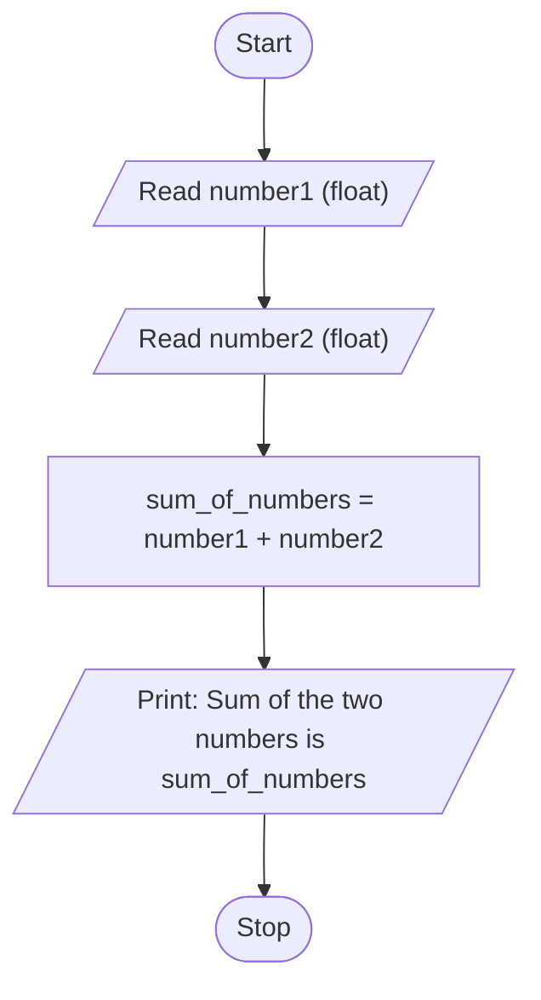

# Unit 1 Task 1 — Example full observation

Faculty reference for a complete **Full** lab observation (Task, Aim, Algorithm, Flowchart, Pseudocode, Python program, Saved file location, Test cases). Students prepare their own write-up before lab.

## Right-hand page

### Task

Write a python program to read two numbers and display their sum.

### Aim

To read two numbers from the user and display their sum.

### Algorithm

1. Start
2. Read number1 and number2
3. Compute sum_of_numbers = number1 + number2
4. Display sum_of_numbers
5. Stop

### Python program

```python
# Example: sum of two numbers
number1 = float(input("Enter first number: "))
number2 = float(input("Enter second number: "))
sum_of_numbers = number1 + number2
print(f"Sum of the two numbers is {sum_of_numbers}")
```

### Saved file location

`Unit-1_Task-1_Sum_of_Two_Numbers.py` (repository root)

## Left-hand page

### Flowchart



### Pseudocode

```
BEGIN
    READ number1, number2
    sum_of_numbers ← number1 + number2
    PRINT sum_of_numbers
END
```

### Test cases

At least **5** cases; at least **2** tricky (edge / boundary / unusual). Actual output shown as when the program is correct.

| # | Input | Expected output | Actual output | Type |
|---|-------|-----------------|---------------|------|
| 1 | 10, 20 | Sum of the two numbers is 30.0 | Sum of the two numbers is 30.0 | Normal |
| 2 | -5, 8 | Sum of the two numbers is 3.0 | Sum of the two numbers is 3.0 | Normal |
| 3 | 2.5, 3.5 | Sum of the two numbers is 6.0 | Sum of the two numbers is 6.0 | Normal |
| 4 | 0, 0 | Sum of the two numbers is 0.0 | Sum of the two numbers is 0.0 | Tricky |
| 5 | -10, -20 | Sum of the two numbers is -30.0 | Sum of the two numbers is -30.0 | Tricky |

[Back to hint](../../docs/hints.md#unit-1-task-1) · [Back to lab tasks](../../docs/lab-tasks/README.md)
