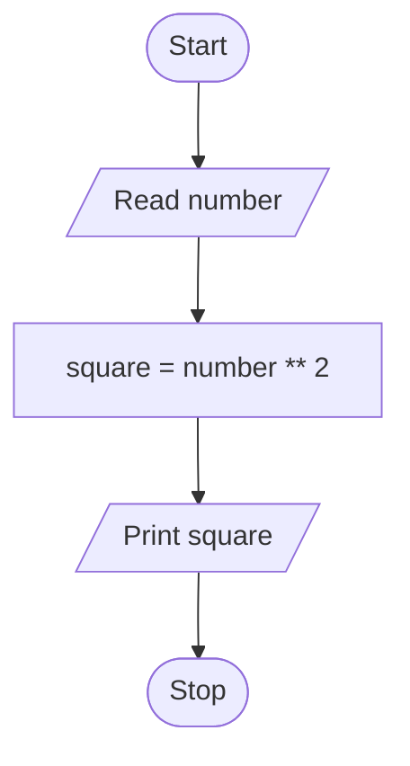

# Unit 1 Task 2 — Example full observation

Faculty reference for a complete **Full** lab observation (Task, Aim, Algorithm, Flowchart, Pseudocode, Python program, Saved file location, Test cases). Students prepare their own write-up before lab.

## Right-hand page

### Task

Write a python program to display the square of a number.

### Aim

To read a number and display its square.

### Algorithm

1. Start
2. Read number
3. Compute square_of_number = number ** 2
4. Display square_of_number
5. Stop

### Python program

```python
# Example: square of a number
number = float(input("Enter a number: "))
square_of_number = number ** 2
print(f"Square of the number is {square_of_number}")
```

### Saved file location

`Unit-1_Task-2_Square_of_a_Number.py` (repository root)

## Left-hand page

### Flowchart



### Pseudocode

```
BEGIN
    READ number
    square_of_number ← number ** 2
    PRINT square_of_number
END
```

### Test cases

At least **5** cases; at least **2** tricky (edge / boundary / unusual). Actual output shown as when the program is correct.

| # | Input | Expected output | Actual output | Type |
|---|-------|-----------------|---------------|------|
| 1 | 5 | Square of the number is 25.0 | Square of the number is 25.0 | Normal |
| 2 | 0 | Square of the number is 0.0 | Square of the number is 0.0 | Normal |
| 3 | 1.5 | Square of the number is 2.25 | Square of the number is 2.25 | Normal |
| 4 | -4 | Square of the number is 16.0 | Square of the number is 16.0 | Tricky |
| 5 | 0.1 | Square of the number is 0.01 | Square of the number is 0.01 | Tricky |

[Back to hint](../../docs/hints.md#unit-1-task-2) · [Back to lab tasks](../../docs/lab-tasks/README.md)
