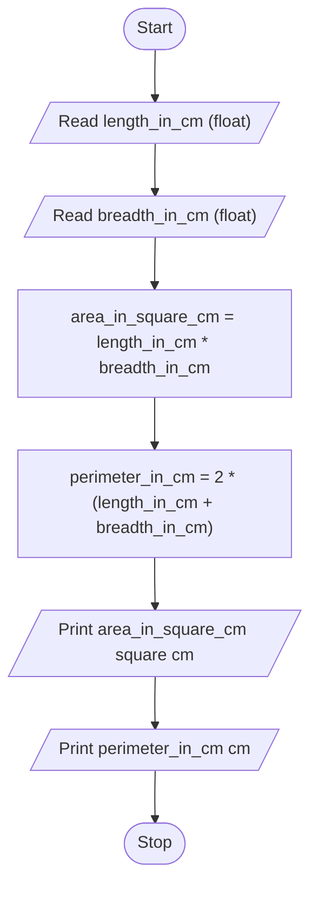

# Unit 1 Task 3 — Example full observation

Faculty reference for a complete **Full** lab observation (Task, Aim, Algorithm, Flowchart, Pseudocode, Python program, Saved file location, Test cases). Students prepare their own write-up before lab.

## Right-hand page

### Task

Write a python program to calculate area and perimeter of a rectangle.

### Aim

To calculate the area and perimeter of a rectangle from length and breadth.

### Algorithm

1. Start
2. Read length_in_cm and breadth_in_cm
3. Compute area_in_square_cm = length_in_cm * breadth_in_cm
4. Compute perimeter_in_cm = 2 * (length_in_cm + breadth_in_cm)
5. Display area and perimeter
6. Stop

### Python program

```python
# Example: rectangle area and perimeter
length_in_cm = float(input("Enter length in cm: "))
breadth_in_cm = float(input("Enter breadth in cm: "))
area_in_square_cm = length_in_cm * breadth_in_cm
perimeter_in_cm = 2 * (length_in_cm + breadth_in_cm)
print(f"Area of the rectangle is {area_in_square_cm} square cm")
print(f"Perimeter of the rectangle is {perimeter_in_cm} cm")
```

### Saved file location

`Unit-1_Task-3_Rectangle_Area_Perimeter.py` (repository root)

## Left-hand page

### Flowchart



### Pseudocode

```
BEGIN
    READ length_in_cm, breadth_in_cm
    area_in_square_cm ← length_in_cm * breadth_in_cm
    perimeter_in_cm ← 2 * (length_in_cm + breadth_in_cm)
    PRINT area_in_square_cm, perimeter_in_cm
END
```

### Test cases

At least **5** cases; at least **2** tricky (edge / boundary / unusual). Actual output shown as when the program is correct.

| # | Input | Expected output | Actual output | Type |
|---|-------|-----------------|---------------|------|
| 1 | 10, 5 | Area 50.0 sq cm; Perimeter 30.0 cm | Area 50.0 sq cm; Perimeter 30.0 cm | Normal |
| 2 | 7, 7 | Area 49.0 sq cm; Perimeter 28.0 cm | Area 49.0 sq cm; Perimeter 28.0 cm | Normal |
| 3 | 2.5, 4 | Area 10.0 sq cm; Perimeter 13.0 cm | Area 10.0 sq cm; Perimeter 13.0 cm | Normal |
| 4 | 1, 100 | Area 100.0 sq cm; Perimeter 202.0 cm | Area 100.0 sq cm; Perimeter 202.0 cm | Tricky |
| 5 | 0.5, 0.5 | Area 0.25 sq cm; Perimeter 2.0 cm | Area 0.25 sq cm; Perimeter 2.0 cm | Tricky |

[Back to hint](../../docs/hints.md#unit-1-task-3) · [Back to lab tasks](../../docs/lab-tasks/README.md)
