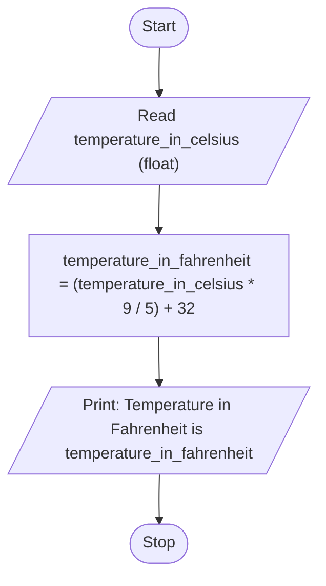

# Unit 1 Task 4 — Example full observation

Faculty reference for a complete **Full** lab observation (Task, Aim, Algorithm, Flowchart, Pseudocode, Python program, Saved file location, Test cases). Students prepare their own write-up before lab.

## Right-hand page

### Task

Write a python program to convert temperature from Celsius to Fahrenheit.

### Aim

To convert a temperature from Celsius to Fahrenheit using the standard formula.

### Algorithm

1. Start
2. Read temperature_in_celsius
3. Compute temperature_in_fahrenheit = (temperature_in_celsius * 9 / 5) + 32
4. Display temperature_in_fahrenheit
5. Stop

### Python program

```python
# Example: Celsius to Fahrenheit
temperature_in_celsius = float(input("Enter temperature in Celsius: "))
temperature_in_fahrenheit = (temperature_in_celsius * 9 / 5) + 32
print(f"Temperature in Fahrenheit is {temperature_in_fahrenheit}")
```

### Saved file location

`Unit-1_Task-4_Celsius_to_Fahrenheit.py` (repository root)

## Left-hand page

### Flowchart



### Pseudocode

```
BEGIN
    READ temperature_in_celsius
    temperature_in_fahrenheit ← (temperature_in_celsius * 9 / 5) + 32
    PRINT temperature_in_fahrenheit
END
```

### Test cases

At least **5** cases; at least **2** tricky (edge / boundary / unusual). Actual output shown as when the program is correct.

| # | Input | Expected output | Actual output | Type |
|---|-------|-----------------|---------------|------|
| 1 | 25 | Temperature in Fahrenheit is 77.0 | Temperature in Fahrenheit is 77.0 | Normal |
| 2 | 0 | Temperature in Fahrenheit is 32.0 | Temperature in Fahrenheit is 32.0 | Normal |
| 3 | 100 | Temperature in Fahrenheit is 212.0 | Temperature in Fahrenheit is 212.0 | Normal |
| 4 | -40 | Temperature in Fahrenheit is -40.0 | Temperature in Fahrenheit is -40.0 | Tricky |
| 5 | 37 | Temperature in Fahrenheit is 98.6 | Temperature in Fahrenheit is 98.6 | Tricky |

[Back to hint](../../docs/hints.md#unit-1-task-4) · [Back to lab tasks](../../docs/lab-tasks/README.md)
