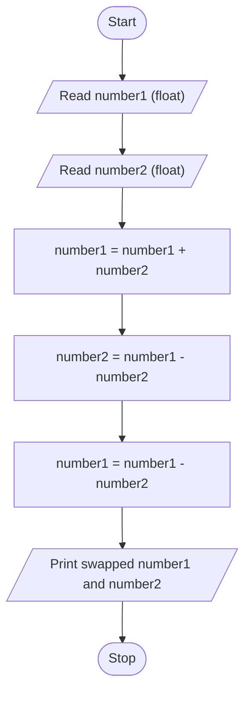

# Unit 1 Task 5 — Example full observation

Faculty reference for a complete **Full** lab observation (Task, Aim, Algorithm, Flowchart, Pseudocode, Python program, Saved file location, Test cases). Students prepare their own write-up before lab.

## Right-hand page

### Task

Write a python program to swap two numbers without using a third variable.

### Aim

To exchange the values of two numbers without using a third variable (arithmetic approach).

### Algorithm

1. Start
2. Read number1 and number2
3. Set number1 = number1 + number2
4. Set number2 = number1 - number2
5. Set number1 = number1 - number2
6. Display number1 and number2
7. Stop

### Python program

```python
# Example: swap two numbers without a third variable
number1 = float(input("Enter first number: "))
number2 = float(input("Enter second number: "))
number1 = number1 + number2
number2 = number1 - number2
number1 = number1 - number2
print(f"After swapping, first number is {number1} and second number is {number2}")
```

### Saved file location

`Unit-1_Task-5_Swap_Two_Numbers.py` (repository root)

## Left-hand page

### Flowchart



### Pseudocode

```
BEGIN
    READ number1, number2
    number1 ← number1 + number2
    number2 ← number1 - number2
    number1 ← number1 - number2
    PRINT number1, number2
END
```

### Test cases

At least **5** cases; at least **2** tricky (edge / boundary / unusual). Actual output shown as when the program is correct.

| # | Input | Expected output | Actual output | Type |
|---|-------|-----------------|---------------|------|
| 1 | 10, 20 | first 20.0, second 10.0 | first 20.0, second 10.0 | Normal |
| 2 | 5, 5 | first 5.0, second 5.0 | first 5.0, second 5.0 | Normal |
| 3 | -3, 7 | first 7.0, second -3.0 | first 7.0, second -3.0 | Normal |
| 4 | 0, 15 | first 15.0, second 0.0 | first 15.0, second 0.0 | Tricky |
| 5 | -8, -2 | first -2.0, second -8.0 | first -2.0, second -8.0 | Tricky |

[Back to hint](../../docs/hints.md#unit-1-task-5) · [Back to lab tasks](../../docs/lab-tasks/README.md)
