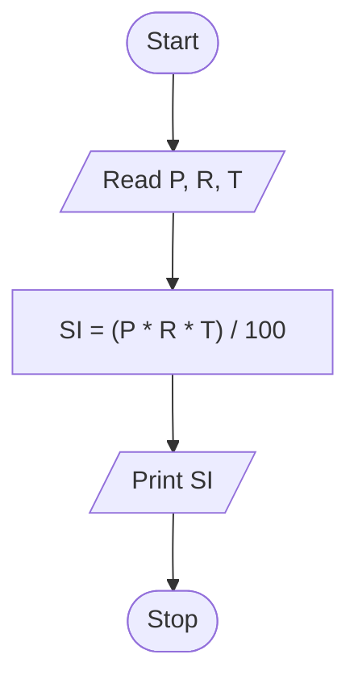

# Unit 1 Task 6 — Example full observation

Faculty reference for a complete **Full** lab observation (Task, Aim, Algorithm, Flowchart, Pseudocode, Python program, Saved file location, Test cases). Students prepare their own write-up before lab.

## Right-hand page

### Task

Write a python program to calculate simple interest.

### Aim

To calculate simple interest from principal, rate, and time.

### Algorithm

1. Start
2. Read principal_amount_in_rupees, rate_of_interest_in_percent, time_in_years
3. Compute simple_interest_in_rupees = (P * R * T) / 100
4. Display simple_interest_in_rupees
5. Stop

### Python program

```python
# Example: simple interest
principal_amount_in_rupees = float(input("Enter principal amount in rupees: "))
rate_of_interest_in_percent = float(input("Enter rate of interest in percent: "))
time_in_years = float(input("Enter time in years: "))
simple_interest_in_rupees = (
    principal_amount_in_rupees * rate_of_interest_in_percent * time_in_years
) / 100
print(f"Simple interest is {simple_interest_in_rupees} rupees")
```

### Saved file location

`Unit-1_Task-6_Simple_Interest.py` (repository root)

## Left-hand page

### Flowchart



### Pseudocode

```
BEGIN
    READ principal_amount_in_rupees, rate_of_interest_in_percent, time_in_years
    simple_interest_in_rupees ← (principal_amount_in_rupees * rate_of_interest_in_percent * time_in_years) / 100
    PRINT simple_interest_in_rupees
END
```

### Test cases

At least **5** cases; at least **2** tricky (edge / boundary / unusual). Actual output shown as when the program is correct.

| # | Input | Expected output | Actual output | Type |
|---|-------|-----------------|---------------|------|
| 1 | 10000, 5, 2 | Simple interest is 1000.0 rupees | Simple interest is 1000.0 rupees | Normal |
| 2 | 5000, 10, 1 | Simple interest is 500.0 rupees | Simple interest is 500.0 rupees | Normal |
| 3 | 2000, 7.5, 3 | Simple interest is 450.0 rupees | Simple interest is 450.0 rupees | Normal |
| 4 | 1000, 0, 5 | Simple interest is 0.0 rupees | Simple interest is 0.0 rupees | Tricky |
| 5 | 10000, 5, 0.5 | Simple interest is 250.0 rupees | Simple interest is 250.0 rupees | Tricky |

[Back to hint](../../docs/hints.md#unit-1-task-6) · [Back to lab tasks](../../docs/lab-tasks/README.md)
