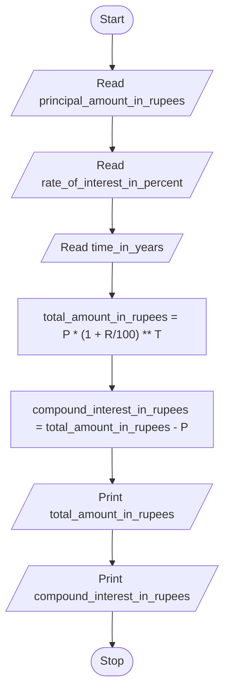

# Unit 1 Task 7 — Example full observation

Faculty reference for a complete **Full** lab observation (Task, Aim, Algorithm, Flowchart, Pseudocode, Python program, Saved file location, Test cases). Students prepare their own write-up before lab.

## Right-hand page

### Task

Write a python program to calculate compound interest.

### Aim

To calculate compound interest and total amount from principal, rate, and time.

### Algorithm

1. Start
2. Read principal_amount_in_rupees, rate_of_interest_in_percent, time_in_years
3. Compute total_amount_in_rupees = P * (1 + R/100) ** T
4. Compute compound_interest_in_rupees = total_amount_in_rupees - P
5. Display total amount and compound interest
6. Stop

### Python program

```python
# Example: compound interest
principal_amount_in_rupees = float(input("Enter principal amount in rupees: "))
rate_of_interest_in_percent = float(input("Enter rate of interest in percent: "))
time_in_years = float(input("Enter time in years: "))
total_amount_in_rupees = principal_amount_in_rupees * (
    1 + rate_of_interest_in_percent / 100
) ** time_in_years
compound_interest_in_rupees = total_amount_in_rupees - principal_amount_in_rupees
print(f"Total amount is {total_amount_in_rupees} rupees")
print(f"Compound interest is {compound_interest_in_rupees} rupees")
```

### Saved file location

`Unit-1_Task-7_Compound_Interest.py` (repository root)

## Left-hand page

### Flowchart



### Pseudocode

```
BEGIN
    READ principal_amount_in_rupees, rate_of_interest_in_percent, time_in_years
    total_amount_in_rupees ← principal_amount_in_rupees * (1 + rate_of_interest_in_percent / 100) ** time_in_years
    compound_interest_in_rupees ← total_amount_in_rupees - principal_amount_in_rupees
    PRINT total_amount_in_rupees, compound_interest_in_rupees
END
```

### Test cases

At least **5** cases; at least **2** tricky (edge / boundary / unusual). Actual output shown as when the program is correct.

| # | Input | Expected output | Actual output | Type |
|---|-------|-----------------|---------------|------|
| 1 | 10000, 5, 2 | Total 11025.0; CI 1025.0 | Total 11025.0; CI 1025.0 | Normal |
| 2 | 1000, 10, 1 | Total 1100.0; CI 100.0 | Total 1100.0; CI 100.0 | Normal |
| 3 | 5000, 8, 3 | Total ≈ 6298.56; CI ≈ 1298.56 | Total ≈ 6298.56; CI ≈ 1298.56 | Normal |
| 4 | 10000, 0, 5 | Total 10000.0; CI 0.0 | Total 10000.0; CI 0.0 | Tricky |
| 5 | 1000, 10, 0 | Total 1000.0; CI 0.0 | Total 1000.0; CI 0.0 | Tricky |

[Back to hint](../../docs/hints.md#unit-1-task-7) · [Back to lab tasks](../../docs/lab-tasks/README.md)
