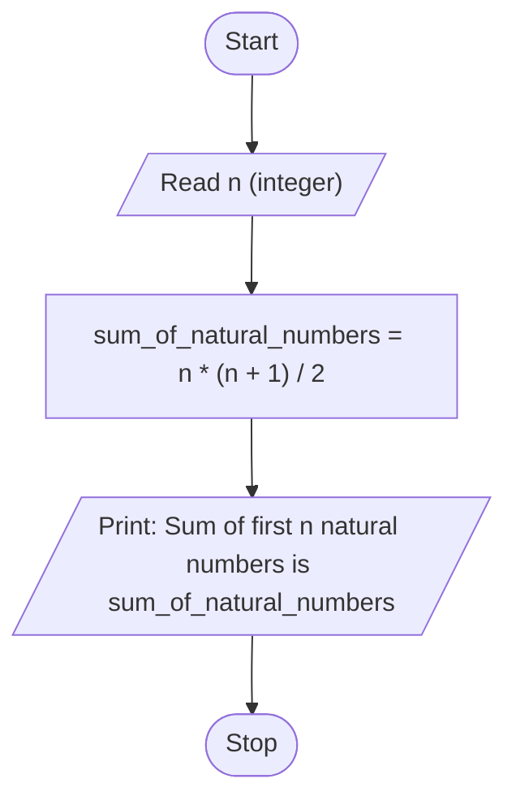

# Unit 1 Task 8 — Example full observation

Faculty reference for a complete **Full** lab observation (Task, Aim, Algorithm, Flowchart, Pseudocode, Python program, Saved file location, Test cases). Students prepare their own write-up before lab.

## Right-hand page

### Task

Write a python program to find the sum of first N natural numbers using a formula.

### Aim

To find the sum of the first N natural numbers using the formula N*(N+1)/2.

### Algorithm

1. Start
2. Read n
3. Compute sum_of_natural_numbers = n * (n + 1) / 2
4. Display sum_of_natural_numbers
5. Stop

### Python program

```python
# Example: sum of first N natural numbers (formula)
n = int(input("Enter the value of n: "))
sum_of_natural_numbers = n * (n + 1) / 2
print(f"Sum of first {n} natural numbers is {sum_of_natural_numbers}")
```

### Saved file location

`Unit-1_Task-8_Sum_of_N_Natural_Numbers.py` (repository root)

## Left-hand page

### Flowchart



### Pseudocode

```
BEGIN
    READ n
    sum_of_natural_numbers ← n * (n + 1) / 2
    PRINT sum_of_natural_numbers
END
```

### Test cases

At least **5** cases; at least **2** tricky (edge / boundary / unusual). Actual output shown as when the program is correct.

| # | Input | Expected output | Actual output | Type |
|---|-------|-----------------|---------------|------|
| 1 | 10 | Sum of first 10 natural numbers is 55.0 | Sum of first 10 natural numbers is 55.0 | Normal |
| 2 | 1 | Sum of first 1 natural numbers is 1.0 | Sum of first 1 natural numbers is 1.0 | Normal |
| 3 | 100 | Sum of first 100 natural numbers is 5050.0 | Sum of first 100 natural numbers is 5050.0 | Normal |
| 4 | 0 | Sum of first 0 natural numbers is 0.0 | Sum of first 0 natural numbers is 0.0 | Tricky |
| 5 | 2 | Sum of first 2 natural numbers is 3.0 | Sum of first 2 natural numbers is 3.0 | Tricky |

[Back to hint](../../docs/hints.md#unit-1-task-8) · [Back to lab tasks](../../docs/lab-tasks/README.md)
