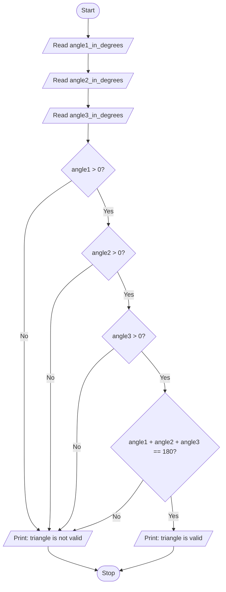

# Unit 2A Task 1 — Example full observation

Faculty reference for a complete **Full** lab observation (Task, Aim, Algorithm, Flowchart, Pseudocode, Python program, Saved file location, Test cases). Students prepare their own write-up before lab.

## Right-hand page

### Task

Write a python program to check whether a triangle is valid given its three angles.

### Aim

To check whether three given angles form a valid triangle (all positive and sum to 180°).

### Algorithm

1. Start
2. Read angle1, angle2, angle3
3. If all angles > 0 and angle1 + angle2 + angle3 == 180, then print valid; else print not valid
4. Stop

### Python program

```python
# Example solution: valid triangle from three angles
angle1_in_degrees = float(input("Enter first angle in degrees: "))
angle2_in_degrees = float(input("Enter second angle in degrees: "))
angle3_in_degrees = float(input("Enter third angle in degrees: "))

if (
    angle1_in_degrees > 0
    and angle2_in_degrees > 0
    and angle3_in_degrees > 0
    and angle1_in_degrees + angle2_in_degrees + angle3_in_degrees == 180
):
    print(
        f"The triangle with angles {angle1_in_degrees}, "
        f"{angle2_in_degrees}, and {angle3_in_degrees} is valid"
    )
else:
    print(
        f"The triangle with angles {angle1_in_degrees}, "
        f"{angle2_in_degrees}, and {angle3_in_degrees} is not valid"
    )
```

### Saved file location

`Unit-2A_Task-1_Valid_Triangle_Angles.py` (repository root)

## Left-hand page

### Flowchart



### Pseudocode

```
BEGIN
    READ angle1, angle2, angle3
    IF angle1 > 0 AND angle2 > 0 AND angle3 > 0 AND angle1 + angle2 + angle3 = 180 THEN
        PRINT "valid"
    ELSE
        PRINT "not valid"
    ENDIF
END
```

### Test cases

At least **5** cases; at least **2** tricky (edge / boundary / unusual). Actual output shown as when the program is correct.

| # | Input | Expected output | Actual output | Type |
|---|-------|-----------------|---------------|------|
| 1 | 60, 60, 60 | valid | valid | Normal |
| 2 | 90, 45, 45 | valid | valid | Normal |
| 3 | 100, 40, 40 | valid | valid | Normal |
| 4 | 90, 90, 90 | not valid (sum 270) | not valid | Tricky |
| 5 | 0, 90, 90 | not valid (zero angle) | not valid | Tricky |

[Back to hint](../../docs/hints.md#unit-2a-task-1) · [Back to lab tasks](../../docs/lab-tasks/README.md)
