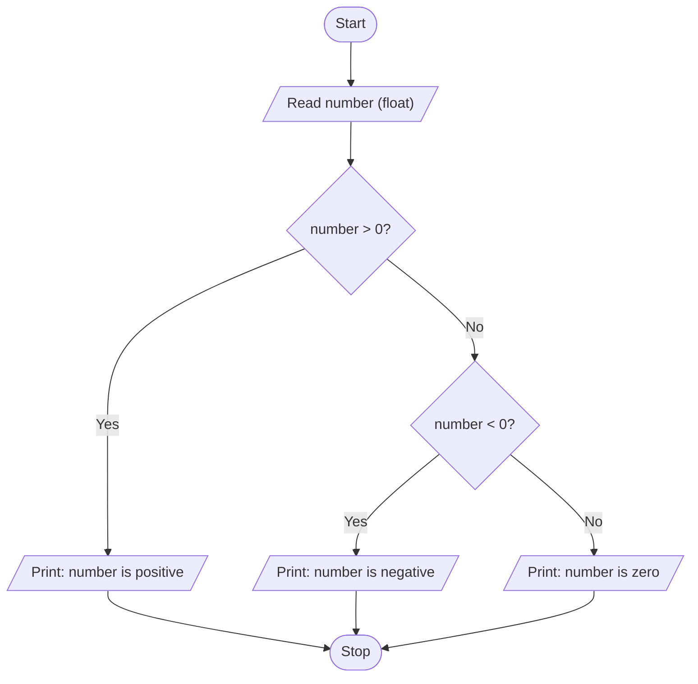

# Unit 2A Task 3 — Example full observation

Faculty reference for a complete **Full** lab observation (Task, Aim, Algorithm, Flowchart, Pseudocode, Python program, Saved file location, Test cases). Students prepare their own write-up before lab.

## Right-hand page

### Task

Write a python program to check whether a number is positive, negative, or zero.

### Aim

To classify a given number as positive, negative, or zero using if-elif-else.

### Algorithm

1. Start
2. Read number
3. If number > 0 print positive; else if number < 0 print negative; else print zero
4. Stop

### Python program

```python
# Example solution: positive, negative, or zero
number = float(input("Enter a number: "))

if number > 0:
    print(f"The number {number} is positive")
elif number < 0:
    print(f"The number {number} is negative")
else:
    print(f"The number {number} is zero")
```

### Saved file location

`Unit-2A_Task-3_Positive_Negative_Zero.py` (repository root)

## Left-hand page

### Flowchart



### Pseudocode

```
BEGIN
    READ number
    IF number > 0 THEN
        PRINT "positive"
    ELSE IF number < 0 THEN
        PRINT "negative"
    ELSE
        PRINT "zero"
    ENDIF
END
```

### Test cases

At least **5** cases; at least **2** tricky (edge / boundary / unusual). Actual output shown as when the program is correct.

| # | Input | Expected output | Actual output | Type |
|---|-------|-----------------|---------------|------|
| 1 | 5 | positive | positive | Normal |
| 2 | -3 | negative | negative | Normal |
| 3 | 12.5 | positive | positive | Normal |
| 4 | 0 | zero | zero | Tricky |
| 5 | -0.001 | negative | negative | Tricky |

[Back to hint](../../docs/hints.md#unit-2a-task-3) · [Back to lab tasks](../../docs/lab-tasks/README.md)
