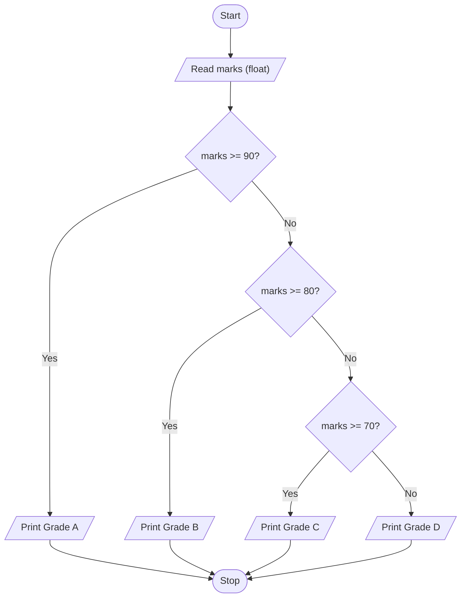

# Unit 2A Task 4 — Example full observation

Faculty reference for a complete **Full** lab observation (Task, Aim, Algorithm, Flowchart, Pseudocode, Python program, Saved file location, Test cases). Students prepare their own write-up before lab.

## Right-hand page

### Task

Write a python program to print the grade of a student using an elif ladder (Marks >= 90 → Grade A; >= 80 and < 90 → Grade B; >= 70 and < 80 → Grade C; < 70 → Grade D).

### Aim

To assign a grade from marks using an if-elif-else ladder.

### Algorithm

1. Start
2. Read marks
3. If marks >= 90 → Grade A; else if marks >= 80 → Grade B; else if marks >= 70 → Grade C; else Grade D
4. Display the grade
5. Stop

### Python program

```python
# Example solution: student grade using elif ladder
marks = float(input("Enter marks: "))

if marks >= 90:
    print(f"Marks {marks}: Grade A")
elif marks >= 80:
    print(f"Marks {marks}: Grade B")
elif marks >= 70:
    print(f"Marks {marks}: Grade C")
else:
    print(f"Marks {marks}: Grade D")
```

### Saved file location

`Unit-2A_Task-4_Student_Grade_Elif_Ladder.py` (repository root)

## Left-hand page

### Flowchart



### Pseudocode

```
BEGIN
    READ marks
    IF marks >= 90 THEN
        grade ← "A"
    ELSE IF marks >= 80 THEN
        grade ← "B"
    ELSE IF marks >= 70 THEN
        grade ← "C"
    ELSE
        grade ← "D"
    ENDIF
    PRINT grade
END
```

### Test cases

At least **5** cases; at least **2** tricky (edge / boundary / unusual). Actual output shown as when the program is correct.

| # | Input | Expected output | Actual output | Type |
|---|-------|-----------------|---------------|------|
| 1 | 95 | Grade A | Grade A | Normal |
| 2 | 85 | Grade B | Grade B | Normal |
| 3 | 75 | Grade C | Grade C | Normal |
| 4 | 90 | Grade A (boundary) | Grade A | Tricky |
| 5 | 69.9 | Grade D (just below 70) | Grade D | Tricky |

[Back to hint](../../docs/hints.md#unit-2a-task-4) · [Back to lab tasks](../../docs/lab-tasks/README.md)
