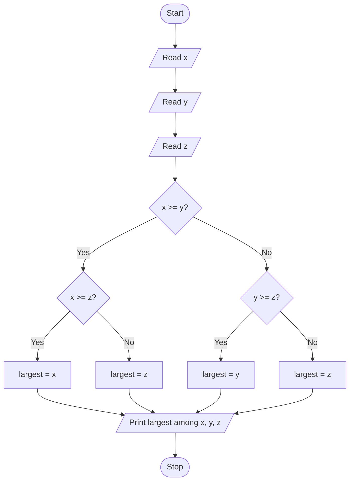

# Unit 2A Task 5 — Example full observation

Faculty reference for a complete **Full** lab observation (Task, Aim, Algorithm, Flowchart, Pseudocode, Python program, Saved file location, Test cases). Students prepare their own write-up before lab.

## Right-hand page

### Task

Write a python program to find the largest of three numbers using nested if.

### Aim

To find the largest among three numbers using nested if statements.

### Algorithm

1. Start
2. Read x, y, z
3. If x >= y: if x >= z then largest = x else largest = z; else if y >= z then largest = y else largest = z
4. Display largest
5. Stop

### Python program

```python
# Example solution: largest of three numbers using nested if
x = int(input("Enter first number: "))
y = int(input("Enter second number: "))
z = int(input("Enter third number: "))

if x >= y:
    if x >= z:
        largest = x
    else:
        largest = z
else:
    if y >= z:
        largest = y
    else:
        largest = z

print(f"Largest = {largest} (among {x}, {y}, {z})")
```

### Saved file location

`Unit-2A_Task-5_Largest_of_Three_Nested_If.py` (repository root)

## Left-hand page

### Flowchart



### Pseudocode

```
BEGIN
    READ x, y, z
    IF x >= y THEN
        IF x >= z THEN
            largest ← x
        ELSE
            largest ← z
        ENDIF
    ELSE
        IF y >= z THEN
            largest ← y
        ELSE
            largest ← z
        ENDIF
    ENDIF
    PRINT largest
END
```

### Test cases

At least **5** cases; at least **2** tricky (edge / boundary / unusual). Actual output shown as when the program is correct.

| # | Input | Expected output | Actual output | Type |
|---|-------|-----------------|---------------|------|
| 1 | 3, 7, 5 | Largest = 7 | Largest = 7 | Normal |
| 2 | 10, 2, 8 | Largest = 10 | Largest = 10 | Normal |
| 3 | 1, 4, 9 | Largest = 9 | Largest = 9 | Normal |
| 4 | 5, 5, 5 | Largest = 5 (all equal) | Largest = 5 | Tricky |
| 5 | -1, -5, -3 | Largest = -1 | Largest = -1 | Tricky |

[Back to hint](../../docs/hints.md#unit-2a-task-5) · [Back to lab tasks](../../docs/lab-tasks/README.md)
