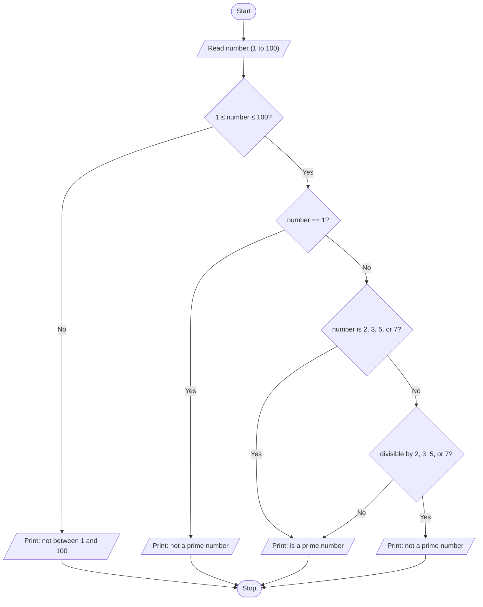

# Unit 2A Task 8 — Example full observation

Faculty reference for a complete **Full** lab observation (Task, Aim, Algorithm, Flowchart, Pseudocode, Python program, Saved file location, Test cases). Students prepare their own write-up before lab.

## Right-hand page

### Task

Write a python program to check whether a given number is prime or not (assume the input number is between 1 and 100).

### Aim

To check whether a number between 1 and 100 is prime using an if-elif ladder (no for loop).

### Algorithm

1. Start
2. Read number
3. If number is not between 1 and 100, print that it is out of range
4. Else if number is 1, print not prime
5. Else if number is 2, 3, 5, or 7, print prime
6. Else if number is divisible by 2, 3, 5, or 7, print not prime
7. Else print prime
8. Stop

### Python program

```python
# Example solution: prime check with if-elif ladder (1 to 100)
number = int(input("Enter a number between 1 and 100: "))

if number < 1 or number > 100:
    print(f"{number} is not between 1 and 100")
elif number == 1:
    print(f"{number} is not a prime number")
elif number == 2 or number == 3 or number == 5 or number == 7:
    print(f"{number} is a prime number")
elif number % 2 == 0 or number % 3 == 0 or number % 5 == 0 or number % 7 == 0:
    print(f"{number} is not a prime number")
else:
    print(f"{number} is a prime number")
```

### Saved file location

`Unit-2A_Task-8_Prime_Number.py` (repository root)

## Left-hand page

### Flowchart



**Mermaid source (copy and paste):**

```
flowchart TD
Start(["Start"])
R1[/"Read number (1 to 100)"/]
D0{"1 ≤ number ≤ 100?"}
Out[/"Print: not between 1 and 100"/]
D1{"number == 1?"}
Not1[/"Print: not a prime number"/]
D2{"number is 2, 3, 5, or 7?"}
YesP[/"Print: is a prime number"/]
D3{"divisible by 2, 3, 5, or 7?"}
NotP[/"Print: not a prime number"/]
Stop(["Stop"])
Start --> R1 --> D0
D0 -->|No| Out --> Stop
D0 -->|Yes| D1
D1 -->|Yes| Not1 --> Stop
D1 -->|No| D2
D2 -->|Yes| YesP --> Stop
D2 -->|No| D3
D3 -->|Yes| NotP --> Stop
D3 -->|No| YesP
```

### Pseudocode

```
BEGIN
    READ number
    IF number < 1 OR number > 100 THEN
        PRINT "not between 1 and 100"
    ELSE IF number = 1 THEN
        PRINT "not prime"
    ELSE IF number IN {2, 3, 5, 7} THEN
        PRINT "prime"
    ELSE IF number divisible by 2 OR 3 OR 5 OR 7 THEN
        PRINT "not prime"
    ELSE
        PRINT "prime"
    ENDIF
END
```

### Test cases

At least **5** cases; at least **2** tricky (edge / boundary / unusual). Actual output shown as when the program is correct.

| # | Input | Expected output | Actual output | Type |
|---|-------|-----------------|---------------|------|
| 1 | 17 | 17 is a prime number | 17 is a prime number | Normal |
| 2 | 20 | 20 is not a prime number | 20 is not a prime number | Normal |
| 3 | 97 | 97 is a prime number | 97 is a prime number | Normal |
| 4 | 1 | 1 is not a prime number | 1 is not a prime number | Tricky |
| 5 | 100 | 100 is not a prime number | 100 is not a prime number | Tricky |

[Back to hint](../../docs/hints/unit2-control-structures-and-strings.md#unit-2a-task-8) · [Back to lab tasks](../../docs/lab-tasks/unit2-control-structures-and-strings.md)
