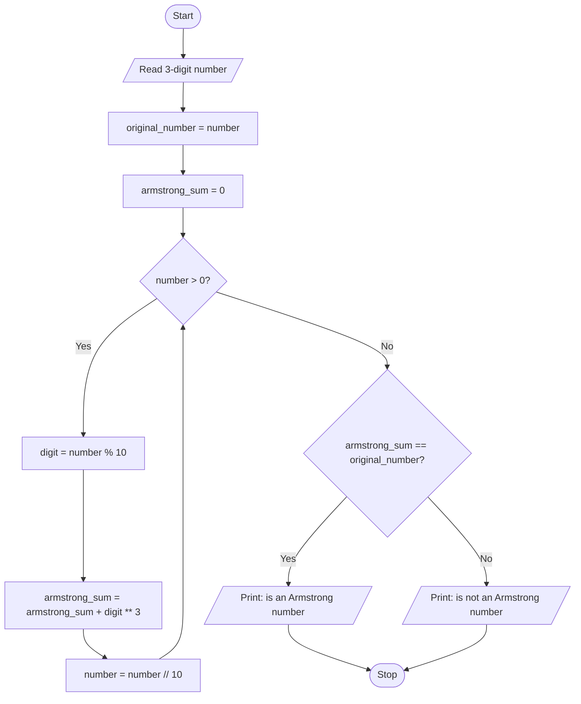

# Unit 2B Task 11 — Example full observation

Faculty reference for a complete **Full** lab observation (Task, Aim, Algorithm, Flowchart, Pseudocode, Python program, Saved file location, Test cases). Students prepare their own write-up before lab.

## Right-hand page

### Task

Write a python program to check whether a number is an Armstrong number using while loop (assume the number has 3 digits).

### Aim

To check whether a 3-digit number is an Armstrong number (sum of cubes of digits equals the number).

### Algorithm

1. Start
2. Read number; save original; armstrong_sum = 0
3. While number > 0: extract digit; armstrong_sum += digit ** 3; number //= 10
4. If armstrong_sum == original print Armstrong; else print not Armstrong
5. Stop

### Python program

```python
# Example solution: 3-digit Armstrong number check using a while loop
number = int(input("Enter a 3-digit number: "))

original_number = number
armstrong_sum = 0

while number > 0:
    digit = number % 10
    armstrong_sum = armstrong_sum + digit ** 3
    number = number // 10

if armstrong_sum == original_number:
    print(
        f"{original_number} is an Armstrong number "
        f"(sum of cubes of digits is {armstrong_sum})"
    )
else:
    print(
        f"{original_number} is not an Armstrong number "
        f"(sum of cubes of digits is {armstrong_sum})"
    )
```

### Saved file location

`Unit-2B_Task-11_Armstrong_Number_While_Loop.py` (repository root)

## Left-hand page

### Flowchart



### Pseudocode

```
BEGIN
    READ number
    original ← number
    armstrong_sum ← 0
    WHILE number > 0 DO
        digit ← number MOD 10
        armstrong_sum ← armstrong_sum + digit ** 3
        number ← number DIV 10
    ENDWHILE
    IF armstrong_sum = original THEN
        PRINT "Armstrong"
    ELSE
        PRINT "not Armstrong"
    ENDIF
END
```

### Test cases

At least **5** cases; at least **2** tricky (edge / boundary / unusual). Actual output shown as when the program is correct.

| # | Input | Expected output | Actual output | Type |
|---|-------|-----------------|---------------|------|
| 1 | 153 | is Armstrong (1^3+5^3+3^3=153) | is Armstrong | Normal |
| 2 | 370 | is Armstrong | is Armstrong | Normal |
| 3 | 371 | is Armstrong | is Armstrong | Normal |
| 4 | 100 | not Armstrong (1) | not Armstrong | Tricky |
| 5 | 999 | not Armstrong (3*729=2187) | not Armstrong | Tricky |

[Back to hint](../../docs/hints.md#unit-2b-task-11) · [Back to lab tasks](../../docs/lab-tasks/README.md)
