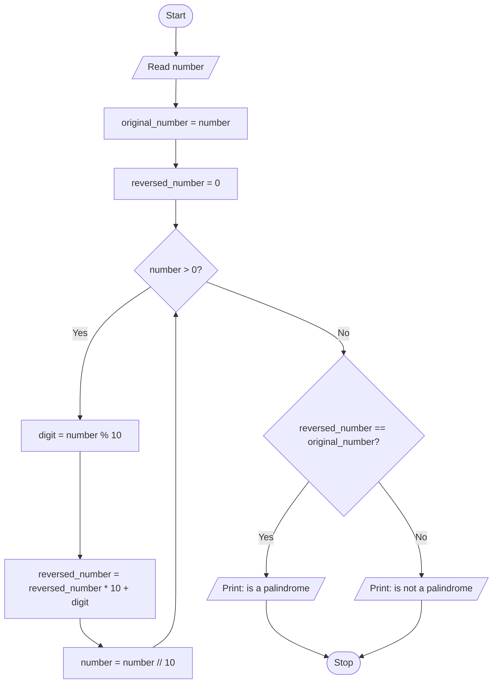

# Unit 2B Task 12 — Example full observation

Faculty reference for a complete **Full** lab observation (Task, Aim, Algorithm, Flowchart, Pseudocode, Python program, Saved file location, Test cases). Students prepare their own write-up before lab.

## Right-hand page

### Task

Write a python program to check whether a number is a palindrome using while loop.

### Aim

To check whether a number reads the same forwards and backwards by reversing its digits with a while loop.

### Algorithm

1. Start
2. Read number; save original; reversed_number = 0
3. While number > 0: extract digit; build reversed_number; number //= 10
4. If reversed_number == original print palindrome; else print not palindrome
5. Stop

### Python program

```python
# Example solution: palindrome number check using a while loop
number = int(input("Enter a number: "))

original_number = number
reversed_number = 0

while number > 0:
    digit = number % 10
    reversed_number = reversed_number * 10 + digit
    number = number // 10

if reversed_number == original_number:
    print(
        f"{original_number} is a palindrome "
        f"(reversed value is {reversed_number})"
    )
else:
    print(
        f"{original_number} is not a palindrome "
        f"(reversed value is {reversed_number})"
    )
```

### Saved file location

`Unit-2B_Task-12_Palindrome_Number_While_Loop.py` (repository root)

## Left-hand page

### Flowchart



### Pseudocode

```
BEGIN
    READ number
    original ← number
    reversed ← 0
    WHILE number > 0 DO
        digit ← number MOD 10
        reversed ← reversed * 10 + digit
        number ← number DIV 10
    ENDWHILE
    IF reversed = original THEN
        PRINT "palindrome"
    ELSE
        PRINT "not palindrome"
    ENDIF
END
```

### Test cases

At least **5** cases; at least **2** tricky (edge / boundary / unusual). Actual output shown as when the program is correct.

| # | Input | Expected output | Actual output | Type |
|---|-------|-----------------|---------------|------|
| 1 | 121 | 121 is a palindrome (reversed value is 121) | 121 is a palindrome (reversed value is 121) | Normal |
| 2 | 123 | 123 is not a palindrome (reversed value is 321) | 123 is not a palindrome (reversed value is 321) | Normal |
| 3 | 1221 | 1221 is a palindrome (reversed value is 1221) | 1221 is a palindrome (reversed value is 1221) | Normal |
| 4 | 7 | 7 is a palindrome (reversed value is 7) | 7 is a palindrome (reversed value is 7) | Tricky |
| 5 | 10 | 10 is not a palindrome (reversed value is 1) | 10 is not a palindrome (reversed value is 1) | Tricky |

[Back to hint](../../docs/hints/unit2-control-structures-and-strings.md#unit-2b-task-12) · [Back to lab tasks](../../docs/lab-tasks/unit2-control-structures-and-strings.md)
