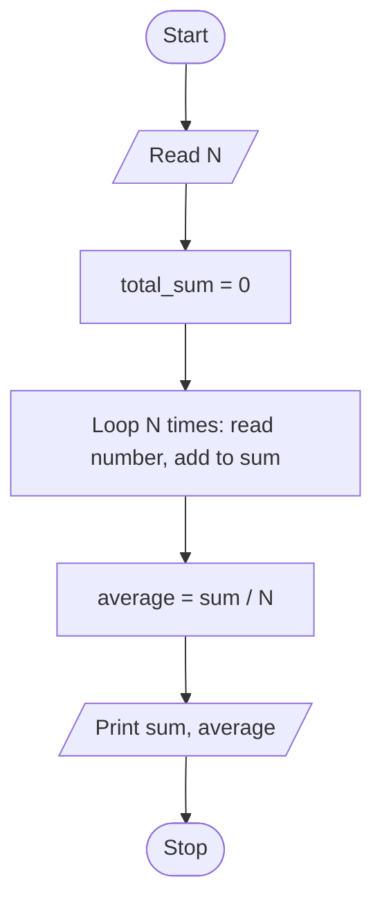

# Unit 2B Task 3 — Example full observation

Faculty reference for a complete **Full** lab observation (Task, Aim, Algorithm, Flowchart, Pseudocode, Python program, Saved file location, Test cases). Students prepare their own write-up before lab.

## Right-hand page

### Task

Write a python program to find the sum and average of N numbers using for loop.

### Aim

To read N numbers, compute their sum and average using a for loop.

### Algorithm

1. Start
2. Read total_input_numbers (N)
3. Initialize total_sum = 0
4. For count from 0 to N-1: read number; total_sum = total_sum + number
5. Compute average = total_sum / N
6. Display sum and average
7. Stop

### Python program

```python
# Example solution: sum and average of N numbers using a for loop
total_input_numbers = int(input("Enter how many numbers: "))

total_sum = 0

for count in range(total_input_numbers):
    number = float(input("Enter a number: "))
    total_sum = total_sum + number

average = total_sum / total_input_numbers

print(f"Sum of {total_input_numbers} numbers is {total_sum}")
print(f"Average of {total_input_numbers} numbers (sum {total_sum}) is {average}")
```

### Saved file location

`Unit-2B_Task-3_Sum_and_Average_of_N_Numbers_For_Loop.py` (repository root)

## Left-hand page

### Flowchart



### Pseudocode

```
BEGIN
    READ N
    total_sum ← 0
    FOR count ← 1 TO N DO
        READ number
        total_sum ← total_sum + number
    ENDFOR
    average ← total_sum / N
    PRINT total_sum, average
END
```

### Test cases

At least **5** cases; at least **2** tricky (edge / boundary / unusual). Actual output shown as when the program is correct.

| # | Input | Expected output | Actual output | Type |
|---|-------|-----------------|---------------|------|
| 1 | N=3; 10, 20, 30 | Sum 60.0; Avg 20.0 | Sum 60.0; Avg 20.0 | Normal |
| 2 | N=2; 5, 15 | Sum 20.0; Avg 10.0 | Sum 20.0; Avg 10.0 | Normal |
| 3 | N=4; 1, 2, 3, 4 | Sum 10.0; Avg 2.5 | Sum 10.0; Avg 2.5 | Normal |
| 4 | N=1; 7 | Sum 7.0; Avg 7.0 | Sum 7.0; Avg 7.0 | Tricky |
| 5 | N=3; -5, 0, 5 | Sum 0.0; Avg 0.0 | Sum 0.0; Avg 0.0 | Tricky |

[Back to hint](../../docs/hints.md#unit-2b-task-3) · [Back to lab tasks](../../docs/lab-tasks/README.md)
