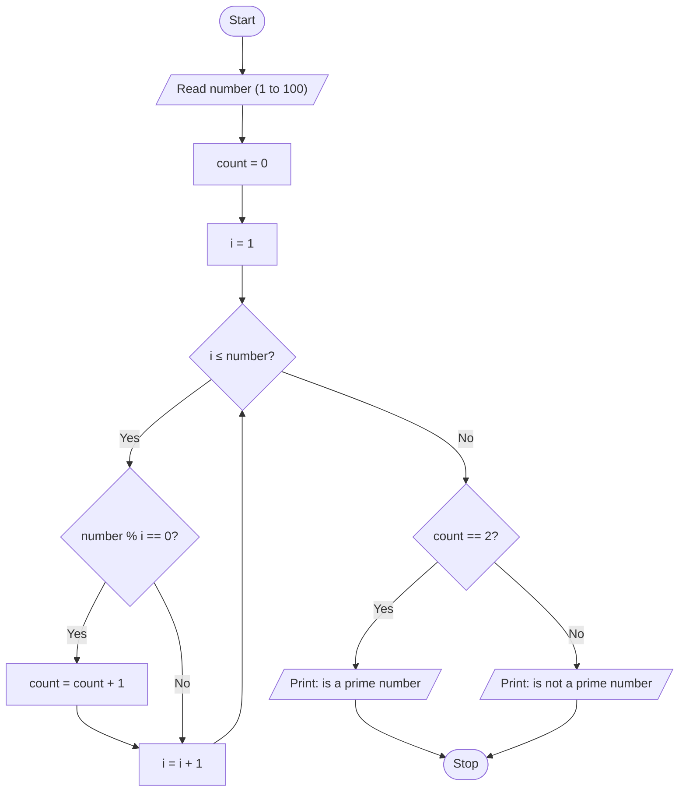

# Unit 2B Task 6 — Example full observation

Faculty reference for a complete **Full** lab observation (Task, Aim, Algorithm, Flowchart, Pseudocode, Python program, Saved file location, Test cases). Students prepare their own write-up before lab.

## Right-hand page

### Task

Write a python program to check whether a given number is prime or not using for loop (assume the input number is between 1 and 100).

### Aim

To check whether a number between 1 and 100 is prime by counting divisors with a for loop.

### Algorithm

1. Start
2. Read number; set count = 0
3. For i from 1 to number: if number % i == 0, increase count by 1
4. If count == 2 print prime; else print not prime
5. Stop

### Python program

```python
# Example solution: prime check using divisor count (for loop)
number = int(input("Enter a number between 1 and 100: "))

count = 0

for i in range(1, number + 1):
    if number % i == 0:
        count = count + 1

if count == 2:
    print(f"{number} is a prime number (divisor count = {count})")
else:
    print(f"{number} is not a prime number (divisor count = {count})")
```

### Saved file location

`Unit-2B_Task-6_Prime_Number_Check_For_Loop.py` (repository root)

## Left-hand page

### Flowchart



### Pseudocode

```
BEGIN
    READ number
    count ← 0
    FOR i ← 1 TO number DO
        IF number MOD i = 0 THEN
            count ← count + 1
        ENDIF
    ENDFOR
    IF count = 2 THEN
        PRINT "prime"
    ELSE
        PRINT "not prime"
    ENDIF
END
```

### Test cases

At least **5** cases; at least **2** tricky (edge / boundary / unusual). Actual output shown as when the program is correct.

| # | Input | Expected output | Actual output | Type |
|---|-------|-----------------|---------------|------|
| 1 | 13 | 13 is a prime number (divisor count = 2) | 13 is a prime number (divisor count = 2) | Normal |
| 2 | 15 | 15 is not a prime number (divisor count = 4) | 15 is not a prime number (divisor count = 4) | Normal |
| 3 | 29 | 29 is a prime number (divisor count = 2) | 29 is a prime number (divisor count = 2) | Normal |
| 4 | 1 | 1 is not a prime number (divisor count = 1) | 1 is not a prime number (divisor count = 1) | Tricky |
| 5 | 2 | 2 is a prime number (divisor count = 2) | 2 is a prime number (divisor count = 2) | Tricky |

[Back to hint](../../docs/hints/unit2-control-structures-and-strings.md#unit-2b-task-6) · [Back to lab tasks](../../docs/lab-tasks/unit2-control-structures-and-strings.md)
