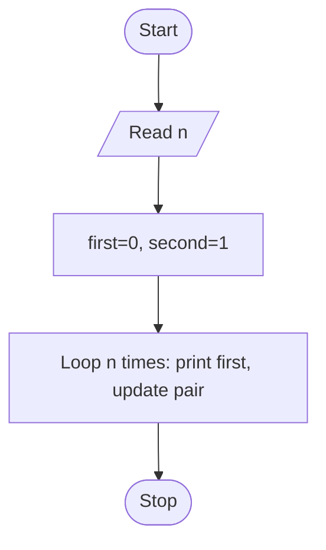

# Unit 2B Task 7 — Example full observation

Faculty reference for a complete **Full** lab observation (Task, Aim, Algorithm, Flowchart, Pseudocode, Python program, Saved file location, Test cases). Students prepare their own write-up before lab.

## Right-hand page

### Task

Write a python program to print Fibonacci series up to N terms using for loop.

### Aim

To print the first N terms of the Fibonacci series using a for loop.

### Algorithm

1. Start
2. Read n
3. Initialize first = 0, second = 1
4. For count from 0 to n-1: print first; next_term = first + second; first = second; second = next_term
5. Stop

### Python program

```python
# Example solution: Fibonacci series up to N terms using a for loop
n = int(input("Enter how many terms: "))

first = 0
second = 1

for count in range(n):
    print(f"Fibonacci series term {count + 1} of {n} terms = {first}")
    next_term = first + second
    first = second
    second = next_term
```

### Saved file location

`Unit-2B_Task-7_Fibonacci_Series_N_Terms_For_Loop.py` (repository root)

## Left-hand page

### Flowchart



### Pseudocode

```
BEGIN
    READ n
    first ← 0
    second ← 1
    FOR count ← 1 TO n DO
        PRINT first
        next_term ← first + second
        first ← second
        second ← next_term
    ENDFOR
END
```

### Test cases

At least **5** cases; at least **2** tricky (edge / boundary / unusual). Actual output shown as when the program is correct.

| # | Input | Expected output | Actual output | Type |
|---|-------|-----------------|---------------|------|
| 1 | 5 | 0 1 1 2 3 | 0 1 1 2 3 | Normal |
| 2 | 7 | 0 1 1 2 3 5 8 | 0 1 1 2 3 5 8 | Normal |
| 3 | 3 | 0 1 1 | 0 1 1 | Normal |
| 4 | 1 | 0 | 0 | Tricky |
| 5 | 2 | 0 1 | 0 1 | Tricky |

[Back to hint](../../docs/hints.md#unit-2b-task-7) · [Back to lab tasks](../../docs/lab-tasks/README.md)
