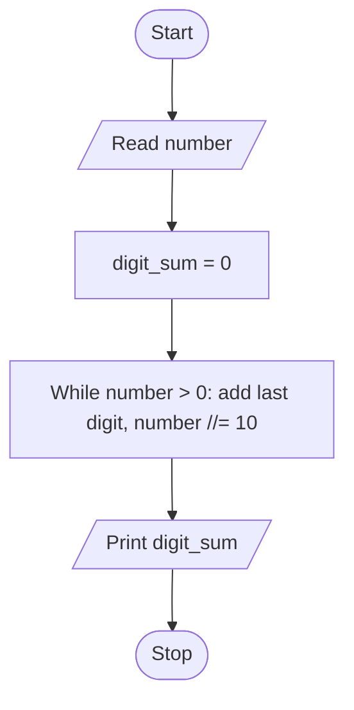

# Unit 2B Task 8 — Example full observation

Faculty reference for a complete **Full** lab observation (Task, Aim, Algorithm, Flowchart, Pseudocode, Python program, Saved file location, Test cases). Students prepare their own write-up before lab.

## Right-hand page

### Task

Write a python program to find the sum of digits of a number using while loop.

### Aim

To find the sum of digits of a positive integer using a while loop.

### Algorithm

1. Start
2. Read number; save original_number; digit_sum = 0
3. While number > 0: digit = number % 10; digit_sum += digit; number //= 10
4. Display digit_sum
5. Stop

### Python program

```python
# Example solution: sum of digits using a while loop
number = int(input("Enter a number: "))

original_number = number
digit_sum = 0

while number > 0:
    digit = number % 10
    digit_sum = digit_sum + digit
    number = number // 10

print(f"Sum of digits of {original_number} is {digit_sum}")
```

### Saved file location

`Unit-2B_Task-8_Sum_of_Digits_While_Loop.py` (repository root)

## Left-hand page

### Flowchart



### Pseudocode

```
BEGIN
    READ number
    original ← number
    digit_sum ← 0
    WHILE number > 0 DO
        digit ← number MOD 10
        digit_sum ← digit_sum + digit
        number ← number DIV 10
    ENDWHILE
    PRINT digit_sum
END
```

### Test cases

At least **5** cases; at least **2** tricky (edge / boundary / unusual). Actual output shown as when the program is correct.

| # | Input | Expected output | Actual output | Type |
|---|-------|-----------------|---------------|------|
| 1 | 123 | Sum of digits of 123 is 6 | Sum of digits of 123 is 6 | Normal |
| 2 | 999 | Sum of digits of 999 is 27 | Sum of digits of 999 is 27 | Normal |
| 3 | 1001 | Sum of digits of 1001 is 2 | Sum of digits of 1001 is 2 | Normal |
| 4 | 0 | Sum of digits of 0 is 0 (loop never runs) | Sum of digits of 0 is 0 | Tricky |
| 5 | 7 | Sum of digits of 7 is 7 | Sum of digits of 7 is 7 | Tricky |

[Back to hint](../../docs/hints.md#unit-2b-task-8) · [Back to lab tasks](../../docs/lab-tasks/README.md)
