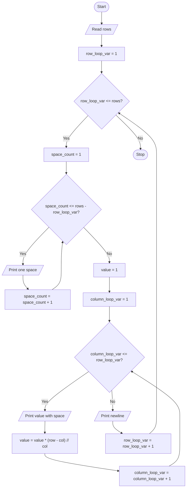

# Unit 2C Task 13 — Example full observation

Faculty reference for a complete **Full** lab observation (Task, Aim, Algorithm, Flowchart, Pseudocode, Python program, Saved file location, Test cases). Students prepare their own write-up before lab.

## Right-hand page

### Task

Write a python program to print Pascal's triangle.

### Aim

To print Pascal's triangle for a given number of rows (centered), computing each value from the previous.

### Algorithm

1. Start
2. Read rows
3. For each row: print leading spaces; initialize value = 1; for each column print value and update value
4. Stop

### Python program

```python
# Example solution: Pascal's triangle
rows = int(input("Enter number of rows: "))

for row_loop_var in range(1, rows + 1):
    for column_loop_var_spaces in range(1, rows - row_loop_var + 1):
        print(" ", end="")
    value = 1
    for column_loop_var in range(1, row_loop_var + 1):
        print(value, end=" ")
        value = value * (row_loop_var - column_loop_var) // column_loop_var
    print()
```

### Saved file location

`Unit-2C_Task-13_Pascals_Triangle.py` (repository root)

## Left-hand page

### Flowchart



### Pseudocode

```
BEGIN
    READ rows
    FOR r ← 1 TO rows DO
        PRINT (rows - r) spaces
        value ← 1
        FOR c ← 1 TO r DO
            PRINT value
            value ← value * (r - c) / c
        ENDFOR
        PRINT newline
    ENDFOR
END
```

### Test cases

At least **5** cases; at least **2** tricky (edge / boundary / unusual). Actual output shown as when the program is correct.

| # | Input | Expected output | Actual output | Type |
|---|-------|-----------------|---------------|------|
| 1 | 5 | 1 / 1 1 / 1 2 1 / 1 3 3 1 / 1 4 6 4 1 | Pascal rows 1..5 | Normal |
| 2 | 3 | 1 / 1 1 / 1 2 1 | Pascal rows 1..3 | Normal |
| 3 | 4 | … / 1 3 3 1 | includes 1 3 3 1 | Normal |
| 4 | 1 | 1 | 1 | Tricky |
| 5 | 2 | 1 / 1 1 | 1 then 1 1 | Tricky |

[Back to hint](../../docs/hints.md#unit-2c-task-13) · [Back to lab tasks](../../docs/lab-tasks/README.md)
