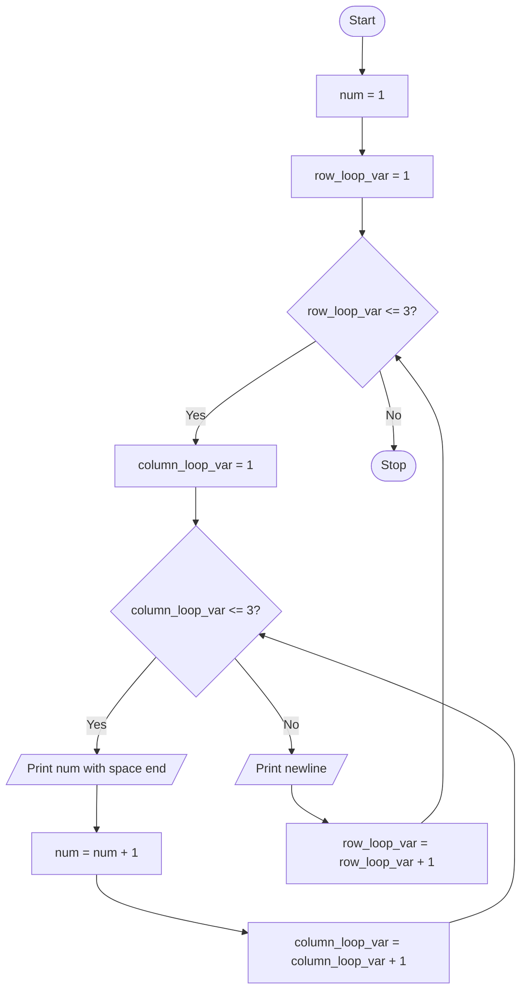

# Unit 2C Task 4 — Example full observation

Faculty reference for a complete **Full** lab observation (Task, Aim, Algorithm, Flowchart, Pseudocode, Python program, Saved file location, Test cases). Students prepare their own write-up before lab.

## Right-hand page

### Task

Write a python program to print numbers in a 3x3 grid using while-for nested loop.

### Aim

To print numbers 1 to 9 in a 3×3 grid using an outer while loop and an inner for loop.

### Algorithm

1. Start
2. Initialize num = 1, row_loop_var = 1
3. While row_loop_var <= 3: for each column 1..3 print num and increment; print newline; increment row
4. Stop

### Python program

```python
# Example solution: 3x3 grid of numbers (while-for)
num = 1
row_loop_var = 1

while row_loop_var <= 3:
    for column_loop_var in range(1, 4):
        print(num, end=" ")
        num = num + 1
    print()
    row_loop_var = row_loop_var + 1
```

### Saved file location

`Unit-2C_Task-4_Three_by_Three_Numbers_While_For.py` (repository root)

## Left-hand page

### Flowchart



### Pseudocode

```
BEGIN
    num ← 1
    row ← 1
    WHILE row ≤ 3 DO
        FOR col ← 1 TO 3 DO
            PRINT num
            num ← num + 1
        ENDFOR
        PRINT newline
        row ← row + 1
    ENDWHILE
END
```

### Test cases

At least **5** cases; at least **2** tricky (edge / boundary / unusual). Actual output shown as when the program is correct.

| # | Input | Expected output | Actual output | Type |
|---|-------|-----------------|---------------|------|
| 1 | (no input) | 1 2 3 / 4 5 6 / 7 8 9 | 1 2 3 / 4 5 6 / 7 8 9 | Normal |
| 2 | Check row count | exactly 3 lines | exactly 3 lines | Normal |
| 3 | Check last value | last printed value is 9 | 9 | Normal |
| 4 | Spacing | spaces between numbers on a row | space-separated | Tricky |
| 5 | First cell | first printed value is 1 | 1 | Tricky |

[Back to hint](../../docs/hints.md#unit-2c-task-4) · [Back to lab tasks](../../docs/lab-tasks/README.md)
