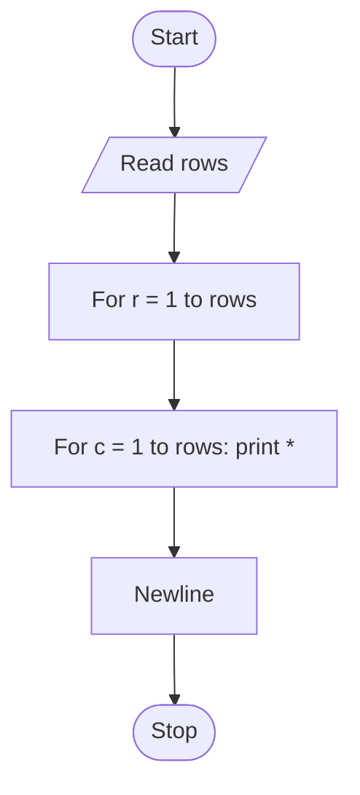

# Unit 2C Task 5 — Example full observation

Faculty reference for a complete **Full** lab observation (Task, Aim, Algorithm, Flowchart, Pseudocode, Python program, Saved file location, Test cases). Students prepare their own write-up before lab.

## Right-hand page

### Task

Write a python program to print a 5x5 grid of stars (*); generalize so the grid size is based on user input.

### Aim

To print an N×N grid of stars where N is read from the user (example: 5×5).

### Algorithm

1. Start
2. Read rows
3. For each row 1..rows: for each column 1..rows print '* '; print newline
4. Stop

### Python program

```python
# Example solution: star grid (generalized)
rows = int(input("Enter grid size (rows and columns): "))

for row_loop_var in range(1, rows + 1):
    for column_loop_var in range(1, rows + 1):
        print("*", end=" ")
    print()
```

### Saved file location

`Unit-2C_Task-5_Star_Grid_User_Input.py` (repository root)

## Left-hand page

### Flowchart



### Pseudocode

```
BEGIN
    READ rows
    FOR r ← 1 TO rows DO
        FOR c ← 1 TO rows DO
            PRINT "* "
        ENDFOR
        PRINT newline
    ENDFOR
END
```

### Test cases

At least **5** cases; at least **2** tricky (edge / boundary / unusual). Actual output shown as when the program is correct.

| # | Input | Expected output | Actual output | Type |
|---|-------|-----------------|---------------|------|
| 1 | 5 | 5×5 full star grid | 5 rows of 5 stars | Normal |
| 2 | 3 | 3×3 full star grid | 3 rows of 3 stars | Normal |
| 3 | 4 | 4×4 full star grid | 4 rows of 4 stars | Normal |
| 4 | 1 | single * | * | Tricky |
| 5 | 2 | * * / * * | 2×2 grid | Tricky |

[Back to hint](../../docs/hints.md#unit-2c-task-5) · [Back to lab tasks](../../docs/lab-tasks/README.md)
