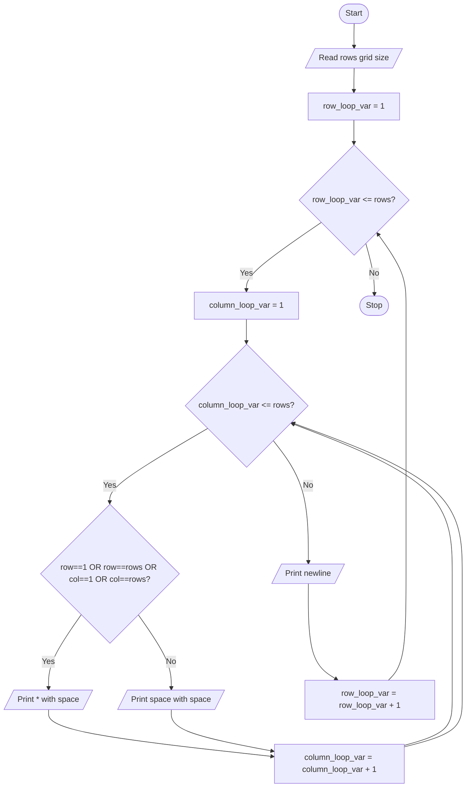

# Unit 2C Task 6 — Example full observation

Faculty reference for a complete **Full** lab observation (Task, Aim, Algorithm, Flowchart, Pseudocode, Python program, Saved file location, Test cases). Students prepare their own write-up before lab.

## Right-hand page

### Task

Write a python program to print a 5x5 hollow grid of stars (*); generalize so the grid size is based on user input.

### Aim

To print an N×N hollow star grid (border only) where N is read from the user.

### Algorithm

1. Start
2. Read rows
3. For each row and column: if on border print '*', else print space
4. Stop

### Python program

```python
# Example solution: hollow star grid (generalized)
rows = int(input("Enter grid size (rows and columns): "))

for row_loop_var in range(1, rows + 1):
    for column_loop_var in range(1, rows + 1):
        if (
            row_loop_var == 1
            or row_loop_var == rows
            or column_loop_var == 1
            or column_loop_var == rows
        ):
            print("*", end=" ")
        else:
            print(" ", end=" ")
    print()
```

### Saved file location

`Unit-2C_Task-6_Hollow_Star_Grid_User_Input.py` (repository root)

## Left-hand page

### Flowchart



### Pseudocode

```
BEGIN
    READ rows
    FOR r ← 1 TO rows DO
        FOR c ← 1 TO rows DO
            IF r = 1 OR r = rows OR c = 1 OR c = rows THEN
                PRINT "* "
            ELSE
                PRINT "  "
            ENDIF
        ENDFOR
        PRINT newline
    ENDFOR
END
```

### Test cases

At least **5** cases; at least **2** tricky (edge / boundary / unusual). Actual output shown as when the program is correct.

| # | Input | Expected output | Actual output | Type |
|---|-------|-----------------|---------------|------|
| 1 | 5 | hollow 5×5 (border stars, hollow inside) | hollow 5×5 | Normal |
| 2 | 4 | hollow 4×4 | hollow 4×4 | Normal |
| 3 | 3 | hollow 3×3 (only center empty) | hollow 3×3 | Normal |
| 4 | 1 | single * (all cells are border) | * | Tricky |
| 5 | 2 | 2×2 all stars (no interior) | * * / * * | Tricky |

[Back to hint](../../docs/hints.md#unit-2c-task-6) · [Back to lab tasks](../../docs/lab-tasks/README.md)
