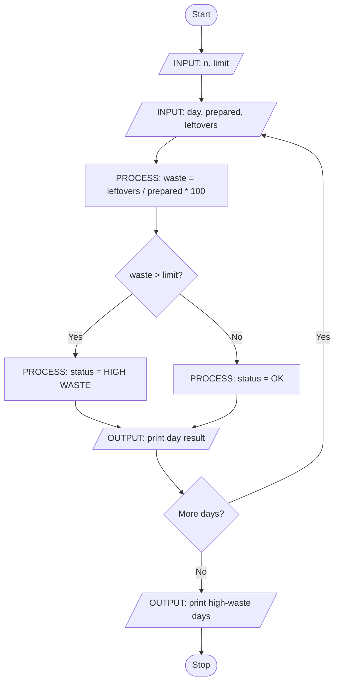

# Case 53: Food Waste Monitoring System

## Aim
Find wastage % for each day and show days that go above the limit.

**Formula:** wastage % = (leftovers / prepared) × 100

---

## INPUT

| Input | Meaning | Example |
|-------|---------|---------|
| n | Number of days | 3 |
| limit | Acceptable wastage % | 10 |
| day | Day name | Mon |
| prepared | Meals prepared | 100 |
| leftovers | Meals left | 20 |

---

## PROCESS

1. For each day, calculate wastage % = (leftovers / prepared) × 100
2. If wastage % > limit → status = HIGH WASTE
3. Else → status = OK
4. Store high-waste day names in a list

---

## OUTPUT

| Output | Meaning | Example |
|--------|---------|---------|
| Day-wise report | day, prepared, leftovers, wastage %, status | Tue 100 20 20.0 HIGH WASTE |
| High-waste days | days above limit | ['Tue'] |

---

## Algorithm

1. Start
2. Read n and limit
3. Create empty list high_waste_days
4. Repeat for each day from 1 to n:
   - Read day, prepared, leftovers
   - Calculate waste = (leftovers / prepared) * 100
   - If waste > limit then status = HIGH WASTE and add day to list
   - Else status = OK
   - Print day result
5. Print high_waste_days
6. Stop

---

## Pseudocode

```text
BEGIN
    INPUT n, limit
    high_waste_days ← empty list

    FOR i ← 1 TO n DO
        INPUT day, prepared, leftovers
        waste ← (leftovers / prepared) * 100

        IF waste > limit THEN
            status ← "HIGH WASTE"
            ADD day TO high_waste_days
        ELSE
            status ← "OK"
        END IF

        OUTPUT day, prepared, leftovers, waste, status
    END FOR

    OUTPUT high_waste_days
END
```

---

## Flowchart

**Shape rules**

| Shape | Meaning |
|-------|---------|
| Oval | Start / Stop |
| Parallelogram | Input / Output |
| Rectangle | Process |
| Diamond | Decision |



---

## Sample

**INPUT**
```text
n = 3
limit = 10
Mon, 100, 8
Tue, 100, 20
Wed, 80, 8
```

**PROCESS**
```text
Mon: (8/100)*100  = 8   → OK
Tue: (20/100)*100 = 20  → HIGH WASTE
Wed: (8/80)*100   = 10  → OK
```

**OUTPUT**
```text
Day   Prepared  Leftovers  Wastage%  Status
Mon   100       8          8.0       OK
Tue   100       20         20.0      HIGH WASTE
Wed   80        8          10.0      OK

Days with high waste: ['Tue']
```

---

## Conclusion
The program takes daily meal data as input, calculates wastage % in process, and shows day status and high-waste days as output.
