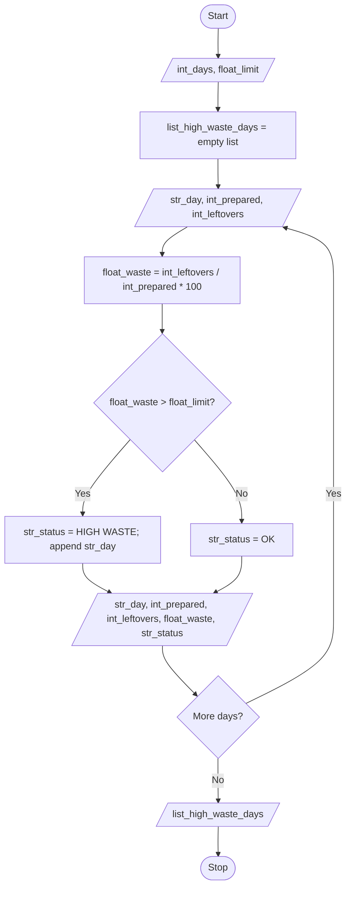

# Case 53: Food Waste Monitoring System

## Aim
Find wastage % for each day and show days that go above the limit.

**Formula:** wastage % = (leftovers / prepared) × 100

---

## INPUT

| Variable | Type | Meaning | Example |
|----------|------|---------|---------|
| int_days | int | Number of days | 3 |
| float_limit | float | Acceptable wastage % | 10 |
| str_day | str | Day name | Mon |
| int_prepared | int | Meals prepared | 100 |
| int_leftovers | int | Meals left | 20 |

---

## PROCESS

1. For each day, calculate `float_waste = (int_leftovers / int_prepared) × 100`
2. If `float_waste` > `float_limit` → `str_status = HIGH WASTE`
3. Else → `str_status = OK`
4. Store high-waste day names in `list_high_waste_days`

---

## OUTPUT

| Variable / report | Meaning | Example |
|-------------------|---------|---------|
| Day-wise report | str_day, int_prepared, int_leftovers, float_waste, str_status | Tue 100 20 20.0 HIGH WASTE |
| list_high_waste_days | days above limit | ['Tue'] |

---

## Algorithm

1. Start
2. Read int_days and float_limit
3. Create empty list list_high_waste_days
4. Repeat for each day from 1 to int_days:
   - Read str_day, int_prepared, int_leftovers
   - Calculate float_waste = (int_leftovers / int_prepared) * 100
   - If float_waste > float_limit then str_status = HIGH WASTE and add str_day to list_high_waste_days
   - Else str_status = OK
   - Print str_day, int_prepared, int_leftovers, float_waste, str_status
5. Print list_high_waste_days
6. Stop

---

## Pseudocode

```text
BEGIN
    INPUT int_days, float_limit
    list_high_waste_days ← empty list

    FOR i ← 1 TO int_days DO
        INPUT str_day, int_prepared, int_leftovers
        float_waste ← (int_leftovers / int_prepared) * 100

        IF float_waste > float_limit THEN
            str_status ← "HIGH WASTE"
            ADD str_day TO list_high_waste_days
        ELSE
            str_status ← "OK"
        END IF

        OUTPUT str_day, int_prepared, int_leftovers, float_waste, str_status
    END FOR

    OUTPUT list_high_waste_days
END
```

---

## Flowchart

**Shape rules**

| Shape | Meaning |
|-------|---------|
| Oval | Start / Stop |
| Parallelogram | Input / Output |
| Rectangle | Process |
| Diamond | Decision |



---

## Sample

**INPUT**
```text
int_days = 3
float_limit = 10
str_day, int_prepared, int_leftovers:
  Mon, 100, 8
  Tue, 100, 20
  Wed, 80, 8
```

**PROCESS**
```text
Mon: float_waste = 8   → str_status = OK
Tue: float_waste = 20  → str_status = HIGH WASTE
Wed: float_waste = 10  → str_status = OK
```

**OUTPUT**
```text
Day   Prepared  Leftovers  Wastage%  Status
Mon   100       8          8.0       OK
Tue   100       20         20.0      HIGH WASTE
Wed   80        8          10.0      OK

list_high_waste_days: ['Tue']
```

---

## Conclusion
The program takes daily meal data as input, calculates wastage % in process, and shows day status and high-waste days as output.
